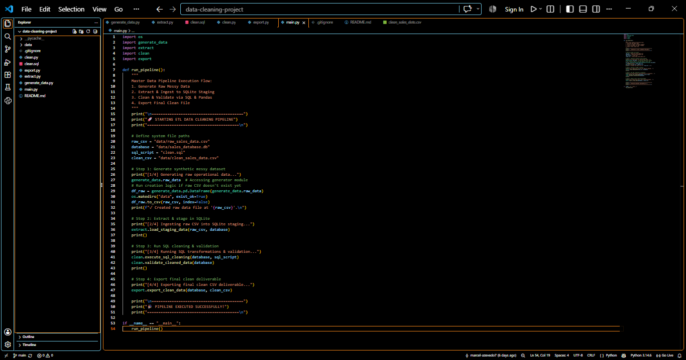
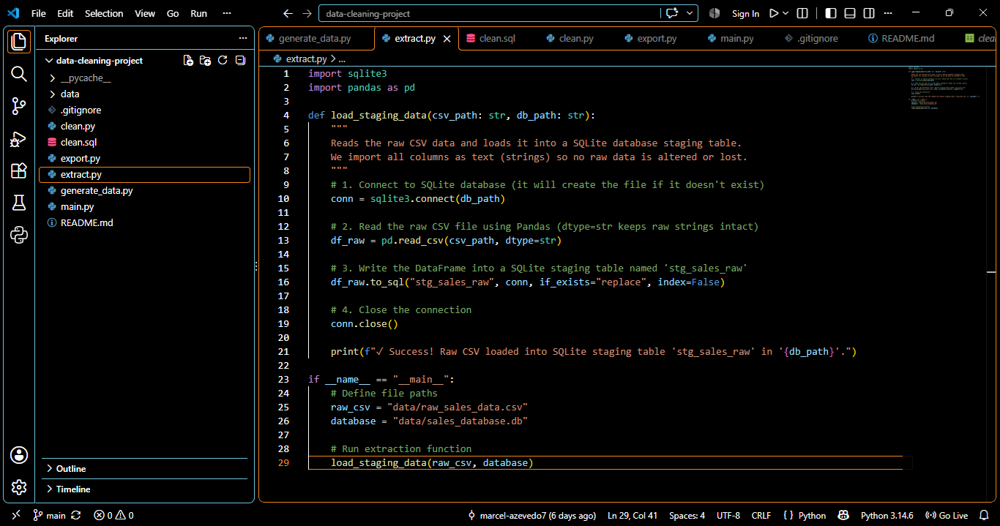
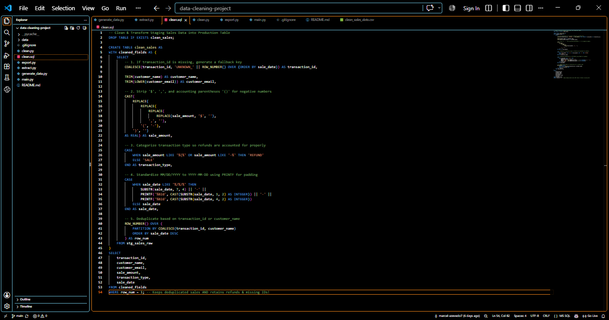
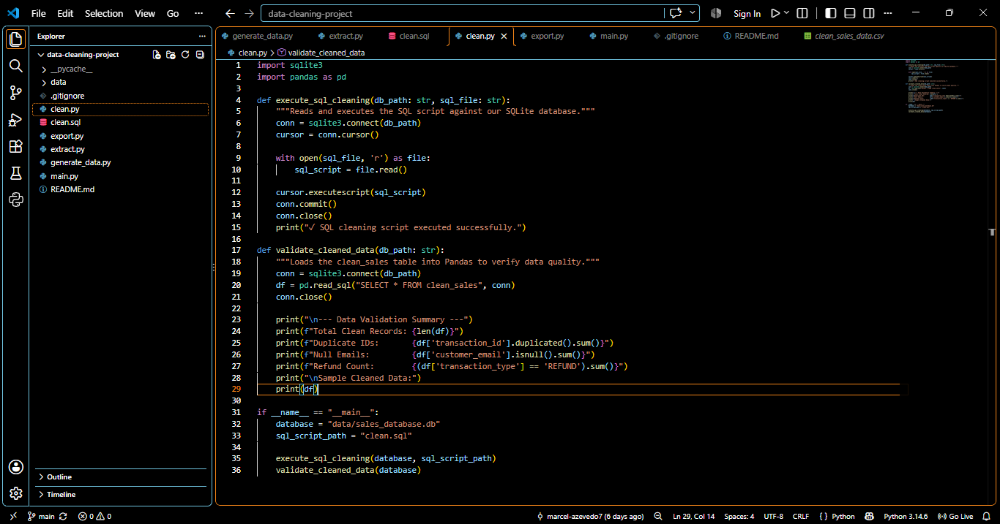
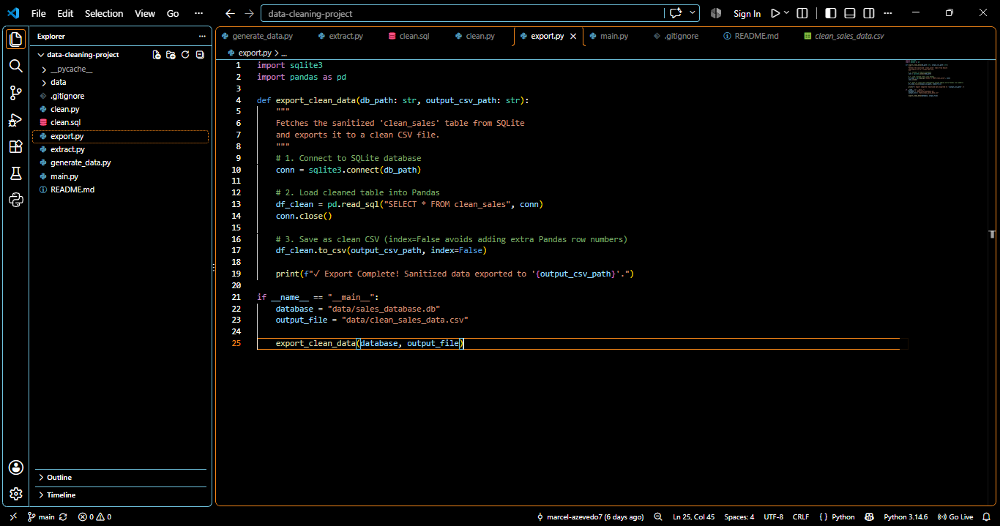

# Production-Grade ETL Sales Data Pipeline

A modular Python and SQL ETL (Extract, Transform, Load) pipeline that ingests raw, unformatted sales data, stages it in SQLite, applies advanced data cleaning and validation, and exports sanitized deliverables.

## Architecture & Data Flow

```text
[ Raw CSV ] ---> [ extract.py ] ---> [ SQLite Staging ]
                                          |
                                    [ clean.sql ] (Transformations)
                                          |
[ Final CSV ] <--- [ export.py ] <--- [ clean.py ] (Validation)
```

**Orchestration:** `main.py` serves as the master pipeline controller, running all stages sequentially in a single command.

## Key Technical Features

* **Data Profiling & Quality:** Cleans numeric formatting (`$`, `,`), normalizes date formats (`YYYY-MM-DD`), and trims string spaces.
* **Auditability & Financial Integrity:** Categorizes refunds (`transaction_type = 'REFUND'`) and assigns fallback keys (`UNKNOWN_X`) to missing IDs rather than silently dropping revenue records.
* **Window Functions:** Utilizes `ROW_NUMBER() OVER (PARTITION BY ...)` in SQL for exact record deduplication.
* **Automated Quality Checks:** Includes Python-based validation reporting on row counts, duplicate IDs, null values, and refund counts.

## Folder Structure

```text
├── data/
│   ├── raw_sales_data.csv
│   └── clean_sales_data.csv
├── generate_data.py
├── extract.py
├── clean.sql
├── clean.py
├── export.py
├── main.py
├── .gitignore
└── README.md
```

## How to Run

1. Clone the repository.
2. Execute the master pipeline:
   ```bash
   python main.py
   ```

## Code Overview
Below are key modules of the ETL pipeline:

### main.py
Master controller that runs all stages sequentially.


### extract.py
Handles data ingestion and staging in SQLite.


### clean.sql
SQL transformations for deduplication and normalization.


### clean.py
Python validation and quality checks.


### export.py
Exports cleaned data to CSV or Excel.

